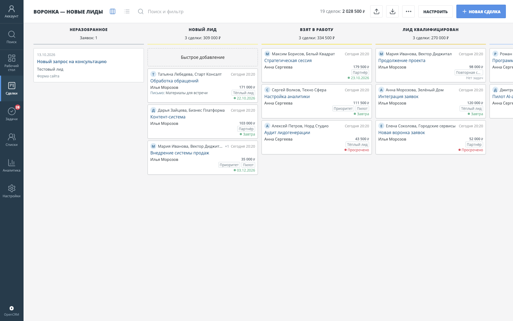

# OpenCRM

[English README](README.md)

**[Открыть живое демо на сайте Polza Agency](https://polzaagency.ru/opencrm)** — настоящая CRM с вымышленными данными. Публичный режим предназначен для просмотра; локальное демо позволяет менять данные.

Самостоятельно размещаемая CRM с интерфейсом в духе классической amoCRM. Код открыт по лицензии MIT. Проект не связан с amoCRM и не использует её API, логотипы или данные.

Приоритет первой версии и критерии приёмки описаны в [базовом ТЗ](docs/MVP_SPEC.md): универсальная CRM для небольшой команды, без внешних интеграций.



## Что работает

- Меню воронок и этапы, доска сделок с перетаскиванием, тегами и сигналом о ближайшей или просроченной задаче, табличный вид и общий список сделок. Последняя воронка и вид «доска/список» сохраняются для пользователя в браузере. Администратор настраивает до семи отображаемых стандартных или дополнительных полей и их порядок на карточках отдельно для каждой воронки, включая последний контакт с клиентом, а также показ аватара контакта. Карточки сделок, контактов и компаний открываются по прямой ссылке; переходы поддерживают кнопки браузера «назад» и «вперёд». Возврат из карточки сделки сохраняет исходную воронку или общий список и поисковый запрос. Кнопка «Новая сделка» позволяет выбрать существующие контакт и компанию либо создать их вместе со сделкой; быстрое добавление в первой колонке тоже создаёт все три записи за одно действие. Адрес новой компании сохраняется в её карточке. Колонки таблицы, включая дополнительные поля, настраиваются и сохраняются отдельно для каждого пользователя; щелчок по заголовку сортирует строки по этому полю. На узком экране сделки показаны карточками с этапом, бюджетом, выбранными полями и сортировкой. В таблице можно выделить несколько сделок и массово сменить ответственного, этап или дополнительное поле, добавить задачу, отредактировать теги либо отправить сделки в корзину.
- Карточка сделки с созданием копии в начале той же воронки (поля и доступные связи копируются, история и файлы остаются в исходной сделке), редактированием полей и этапа на месте, переносом в другую воронку на первый рабочий этап с записью в истории, причиной отказа для закрытой неуспешной сделки, несколькими связанными контактами, заметками, ручной фиксацией звонков, писем и сообщений, закреплением важных примечаний над историей, историей изменений полей, поиском и фильтром событий. Новый контакт можно создать и сразу привязать прямо в карточке сделки. Связанный контакт раскрывается прямо в карточке сделки: видны должность, телефон, email и компания. Ниже показана карточка компании с телефоном, email и сайтом. Быстрые ссылки для звонка и письма открывают системное приложение. Ручные записи коммуникаций не отправляют сообщения клиенту. Ширину блока полей и ленты в карточках сделки, контакта и компании на широком экране можно менять разделителем; выбранная ширина общая и сохраняется в браузере. Открытые задачи стоят в ленте событий по сроку; результат можно записать и завершить задачу прямо в карточке. Есть вкладка других сделок тех же контактов или компании.
- Удаление сделок, задач, контактов и компаний в корзину. Восстановление через настройки возвращает запись вместе с её связями, заметками и файлами.
- Настраиваемые дополнительные поля для сделок, контактов и компаний: текст, число, дата, ссылка и список с вариантами. Значения меняются прямо в карточке или массово в таблице; использованный вариант списка нельзя удалить из настройки поля.
- Локальные вложения для сделок, контактов и компаний с загрузкой и скачиванием (до 15 МБ на файл). Общий экран «Списки → Файлы» показывает все доступные вложения, позволяет искать и фильтровать их, переходить к связанной записи и добавлять файл в выбранную карточку.
- Задачи со сроками, интервалом времени или режимом «Весь день», типами и результатом выполнения: доска, таблица и календарь на день, неделю или месяц. Длинные группы доски раскрываются через «Показать ещё». В таблице можно выделить задачи и массово завершить их с общим результатом, удалить, сменить ответственного, срок или тип. Фильтр позволяет выбрать мои, просроченные и выполненные задачи, а также отобрать их по сроку, типу и менеджеру. Клик по задаче открывает окно результата, из которого её можно изменить или удалить с возможностью восстановления.
- Списки контактов и компаний с поиском по всей базе, фильтром по ответственному, точному тегу и дате создания, быстрыми отборами «без задач», «с просроченными задачами», «без сделок», постраничной навигацией и настраиваемыми для каждого пользователя колонками, включая дополнительные поля. На узких экранах строки показываются карточками с выбранными полями, выделением и кнопкой редактирования. В строках можно выделить записи, массово назначить ответственного, добавить, удалить или заменить теги, изменить дополнительное поле, создать задачи и удалить записи в корзину. Основные поля, теги и ответственный редактируются прямо в карточке; теги и ответственный сохраняются при импорте и экспорте CSV. Карточка показывает историю создания, изменений полей, заметок, файлов и задач с поиском по тексту и фильтром по типу события; поиск также находит будущие задачи. Связанные сделки открываются в отдельной вкладке, а будущие задачи — в компактном блоке с переходом к результату и редактированию. Задачу можно привязать к контакту или компании; она отображается в карточке и общем разделе задач.
- Сотрудники, быстрые фильтры сделок (открытые, мои, выигранные, потерянные, без задач, с просроченными задачами), отбор по этапам, менеджеру, источнику, тегу, дате создания и бюджету. Составной фильтр можно сохранить под именем для своего пользователя, повторно применить или удалить.
- Общий поиск из любого раздела по сделкам, контактам и компаниям, включая контактные данные, дополнительные поля и связанные сделки. В верхней строке «Поиск и фильтр» можно сразу печатать; результаты появляются в выпадающей панели. Кнопка в меню или Cmd/Ctrl+K открывает отдельное окно поиска. Enter без выбранной подсказки ищет только в текущем разделе; ↑/↓ и Enter открывают найденную карточку, Cmd/Ctrl+Enter — в новой вкладке.
- Рабочий стол в стилистике amoCRM с названием аккаунта: плитки задач и сделок по всем воронкам, источники, менеджеры, периоды, поиск и настройка видимости плиток. Сводные показатели считаются в базе по полному набору записей с учётом прав доступа.
- Аналитика с четырьмя экранами: воронка продаж, сводный отчет, показатели сотрудников и журнал событий. Период фильтрует новые сделки, заметки и события; остатки по этапам и открытые задачи показывают текущее состояние.
- Импорт и экспорт сделок, контактов и компаний в CSV, в том числе через компактное меню на узком экране. Контакты из CSV привязываются к компании по названию; отсутствующая компания создаётся при импорте.
- Локальная SQLite база, вход по паролю, роли администратора и сотрудника. Администратор настраивает отдельные права на создание, правку, удаление и экспорт сделок, контактов и компаний; для задач — создание, правку и удаление. Видимость сделок, задач, контактов и компаний можно ограничить ответственным. Сервер проверяет права и для массовых действий, импорта и вложений.
- Настройки аккаунта, пользователей, групп сотрудников, воронок, этапов и дополнительных полей. Администратор может менять названия, роли и доступ; последнего администратора нельзя лишить прав.
- Отдельный редактор воронки с обзором источников, перестановкой этапов и правилом автосоздания задачи после создания сделки или перехода в этап.
- Очередь «Неразобранное»: заявка с контактными данными видна в первой колонке воронки, её можно принять в сделку или отклонить; отклонённую заявку можно восстановить. При принятии повторно используются совпадающие контакт по email и компания по названию.
- Веб-формы в редакторе воронки: публичная ссылка принимает обращения в «Неразобранное», форму можно выключить. На локальном адресе `127.0.0.1` ссылка доступна только с этого компьютера.
- Универсальные интеграции: ключи API с отдельными правами, приём заявок с защитой от дублей, чтение воронок и сделок, смена этапа через API, подписанные исходящие webhooks о заявках и сделках с очередью, повторами и журналом доставок. Подключаются в «Настройки → Интеграции»; [формат запросов и подписи](docs/INTEGRATIONS.md).

## Запуск

Нужен Node.js 22.12+.

```bash
cd opencrm
npm ci
npm run dev
```

Откройте `http://127.0.0.1:5173`. При первом входе интерфейс предложит создать администратора. Данные сохраняются в `data/opencrm.db` (папка игнорируется Git).

При необходимости скопируйте `.env.example` в `.env` и измените локальный порт или путь к базе. `npm run dev` и `npm start` подхватывают `.env`, если он есть. Для запуска после сборки:

```bash
npm run build
npm start
```

После этого адрес: `http://127.0.0.1:3001`. Для доступа из сети настройте HTTPS и `COOKIE_SECURE=1` на доверенном reverse proxy; не открывайте SQLite или серверный порт напрямую в интернет.

Для отдельного запуска в Docker Compose:

```bash
docker compose up --build -d
```

Если Compose установлен отдельной командой, используйте `docker-compose up --build -d`. Контейнер слушает только `127.0.0.1:3001` хоста; порт можно изменить через `OPENCRM_PORT` в `.env`. База и файлы хранятся в томе `opencrm_data`, резервные копии — в отдельном томе `opencrm_backups`. Если публикуете CRM через HTTPS reverse proxy, выставьте `COOKIE_SECURE=1`; само приложение не настраивает TLS.

## Резервная копия

Остановите изменения данных на время копирования вложений. SQLite снимается согласованным снимком даже при открытой базе, но файлы, добавленные или удалённые во время копирования, могут не совпасть со снимком базы.

```bash
npm run backup
npm run backup:verify -- ./backups/opencrm-ИМЯ_КОПИИ
```

Команда создаёт каталог в `./backups` с базой, вложениями и контрольными суммами. `backups/` исключён из Git. Для Docker используйте `docker compose exec opencrm npm run backup`; готовый каталог будет в отдельном томе `opencrm_backups`. Регулярно выгружайте копии за пределы сервера или Docker-хоста: один локальный диск не защищает от его потери.

Для восстановления остановите CRM, сохраните текущие `DATABASE_PATH` и `UPLOAD_DIR` отдельно и освободите оба пути. Затем выполните `npm run backup:restore -- /путь/к/копии`. Команда сперва проверит состав, SHA-256 и целостность SQLite; она откажется перезаписывать существующую базу или каталог вложений. Запустите CRM и проверьте вход, сделки и файлы.

Чтобы посмотреть заполненный интерфейс без настройки аккаунта:

```bash
npm run build
npm run demo
```

Демо открывается на `http://127.0.0.1:3002` и доступно только с этого компьютера. В нём используются вымышленные данные и отдельная временная база; она удаляется при штатной остановке демо. Рабочая база `data/opencrm.db` не затрагивается.

Публичный режим просмотра с вымышленными данными и размещением под путём сайта описан в [инструкции](docs/PUBLIC_DEMO.md).

## Ограничения

Это самостоятельная CRM. Данные из amoCRM не синхронизируются автоматически. Матрица прав amoCRM пока реализована частично: есть ограничение видимости по ответственному, но нет отдельного ограничения по группам и этапам, запрета просмотра раздела и экспорта задач. Исторические записи событий в сделках могут содержать имена ранее связанных контактов и компаний, даже если текущий доступ к ним ограничен. Аналитика доступна сотрудникам только при полном доступе к сделкам и задачам. Встроенных интеграций почты, мессенджеров, телефонии и внешних файловых сервисов пока нет; их можно подключать через универсальные API и webhooks.
