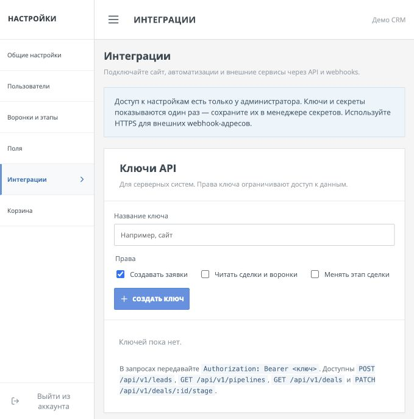
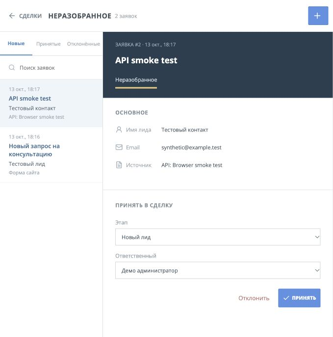

# OpenCRM API and webhooks

OpenCRM 0.2 adds a small, versioned HTTP API and signed outgoing webhooks. They are intended for server-to-server connections such as websites, n8n, Make, and custom services. The current UI for configuring them is **Settings → Интеграции** and is available to administrators only.



## API keys

Create a named key in Settings → Интеграции and select only the scopes the connection needs. Copy the token immediately; the server stores its SHA-256 hash and cannot show it again. Revoking a key takes effect immediately. Send it as `Authorization: Bearer <token>` over HTTPS. Do not put it in browser JavaScript, a public URL, or a Git repository.

| Scope | Operations |
|---|---|
| `leads:write` | Create an inbox lead with `POST /api/v1/leads` |
| `deals:read` | List pipelines and stages; list and read deals |
| `deals:write` | Change the stage of a deal |

All JSON endpoints use `/api/v1` and return `{ "error": "..." }` on failure. An invalid or revoked key gets HTTP 401; a key without the required scope gets 403. API keys are instance-wide service credentials, so grant `deals:read` only to systems allowed to read all deals. The session permissions of individual CRM users do not apply to these keys.

### Create a lead

```bash
curl -X POST 'https://crm.example.com/api/v1/leads' \
  -H 'Authorization: Bearer YOUR_API_KEY' \
  -H 'Content-Type: application/json' \
  -H 'Idempotency-Key: website-form-123' \
  --data '{"pipeline_id":1,"title":"Demo request","contact_name":"Example Person","email":"person@example.test","source":"Website","message":"Please call me"}'
```

Required: a valid `pipeline_id`, a nonempty `title`, and at least one of `contact_name`, `company_name`, `phone`, or `email`. Optional: `website`, `source`, and `message`. The response is HTTP 201 with `{ "id": 123, "status": "pending", "repeated": false }`; the lead appears in **Неразобранное** for review. Repeating the same request with the same `Idempotency-Key` returns HTTP 200 and the original ID. Reusing that key with different data returns HTTP 409. Keys are unique per API key and retained for 30 days.



### Read pipelines and deals

```text
GET /api/v1/pipelines
GET /api/v1/deals?limit=50&after=0
GET /api/v1/deals/123
```

Deal lists use ascending ID cursor pagination. `limit` is 1–100 (default 50). Pass the returned `next_after` value to retrieve the next page; `null` means there are no more rows. Deleted deals are excluded. Deal responses include IDs, stage and pipeline, owner, amount, source, tags, description, and timestamps; they do not include contact phone or email.

### Change a deal stage

```bash
curl -X PATCH 'https://crm.example.com/api/v1/deals/123/stage' \
  -H 'Authorization: Bearer YOUR_API_KEY' \
  -H 'Content-Type: application/json' \
  --data '{"stage_id":8}'
```

The new stage must belong to the deal's current pipeline. Moving to a lost stage requires `loss_reason`. A successful change writes deal history, runs that stage's task automation, and emits `deal.stage_changed`.

## Outgoing webhooks

Create an endpoint in Settings → Интеграции with an HTTPS URL and select events. OpenCRM shows a random signing secret **once**. Rotate it from the same screen when needed. The secret is stored in the local SQLite database to sign future messages, so protect database backups as you protect CRM data.

| Event | When it fires |
|---|---|
| `lead.created` | A lead is added to the inbox, including via a public form or API |
| `deal.created` | A deal is created, including by accepting a lead or CSV import |
| `deal.stage_changed` | A deal changes stage, including through the API or bulk actions |

Each request is an HTTP POST with `Content-Type: application/json`. Example body:

```json
{"id":42,"type":"deal.stage_changed","created_at":"2026-10-13 18:00:00","data":{"id":123,"pipeline_id":1,"previous_stage_id":2,"stage_id":3,"name":"Demo deal","amount":50000,"owner_id":1}}
```

Headers:

- `X-OpenCRM-Event`: event type.
- `X-OpenCRM-Delivery`: stable delivery ID; use it to deduplicate retries.
- `X-OpenCRM-Timestamp`: Unix time in seconds when the request was sent.
- `X-OpenCRM-Signature`: `sha256=` followed by hex HMAC-SHA256 of `timestamp + "." + raw_request_body`, using the endpoint secret.

Check the signature with a constant-time comparison and reject stale timestamps before processing the payload. The JSON `data` can contain contact names, email, and phone for `lead.created`; send webhooks only to services you trust.

A 2xx response marks delivery successful. Network errors and other HTTP statuses are retried up to five times; the delivery log in Settings shows attempts, response status, and errors. After the final failure, use **Повторить** in the log to requeue it. The sender never follows redirects and resolves the host to an IPv4 address before connecting. Private, loopback, link-local, and reserved IPv4 destinations are blocked by default. For a trusted internal service such as n8n, set `OPENCRM_WEBHOOK_ALLOWED_HOSTS=n8n.internal` in the server's `.env` or Compose environment; this exact hostname can then use HTTP or a private IP. For local integration tests only, `OPENCRM_ALLOW_LOCAL_WEBHOOKS=1` permits all HTTP and local addresses; do not use that broad option on a public server.

To verify connectivity without creating CRM data, click **Тест**. It sends a `test.ping` event containing only a short test message, even if `test.ping` is not among the endpoint's subscribed events.

### Signature verification in Node.js

```js
import {createHmac, timingSafeEqual} from 'node:crypto';

function validWebhook(rawBody, timestamp, signature, secret) {
  if (Math.abs(Date.now() / 1000 - Number(timestamp)) > 300) return false;
  const expected = createHmac('sha256', secret).update(`${timestamp}.${rawBody}`).digest();
  const supplied = Buffer.from(String(signature).replace(/^sha256=/, ''), 'hex');
  return supplied.length === expected.length && timingSafeEqual(supplied, expected);
}
```

Read the unmodified request body as bytes or text before parsing JSON; re-serializing an object changes the signature. Return a 2xx status quickly, then process the event asynchronously. Webhooks use at-least-once delivery, so consumers should deduplicate by `X-OpenCRM-Delivery`.
