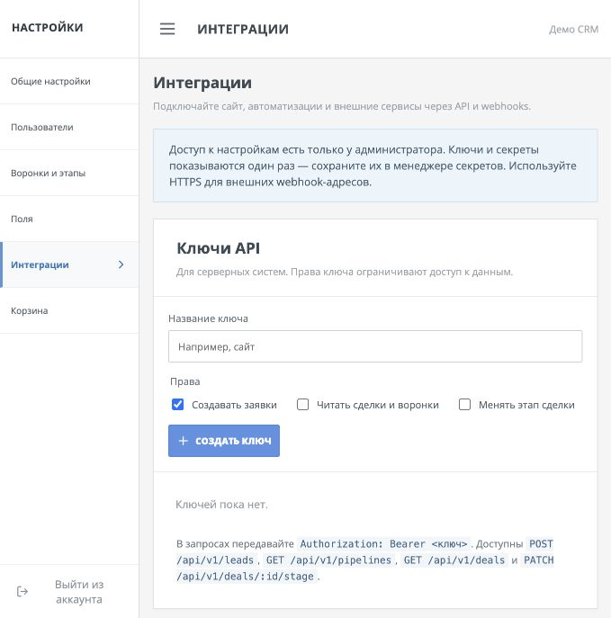
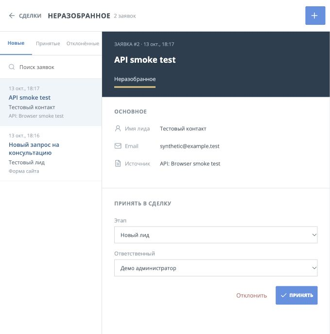

# OpenCRM API and webhooks

OpenCRM has a versioned HTTP API (`/api/v1`) and signed outgoing webhooks for server-to-server connections: a company portal, a website, n8n, Make or a custom service. Through the API an external system can do what an employee does in the interface: create and update deals, contacts, companies and tasks, add notes, read pipelines, set up stages, stage transition rules and custom fields. Integrations are configured in **Settings → Интеграции**, which is available to administrators only.



## API keys

Create a named key in Settings → Интеграции and select only the scopes the connection needs. Copy the token immediately; the server stores its SHA-256 hash and cannot show it again. Revoking a key takes effect immediately. Send it as `Authorization: Bearer <token>` over HTTPS. Do not put it in browser JavaScript, a public URL, or a Git repository.

| Scope | Operations |
|---|---|
| `leads:write` | Create an inbox lead with `POST /api/v1/leads` |
| `deals:read` | Read pipelines, stages, transition rules, deals, deal notes, calls and history; read deal custom fields |
| `deals:write` | Create, update, move and delete deals; link contacts; add notes and calls to deals |
| `contacts:read` / `contacts:write` | Read / create, update, delete contacts and their notes |
| `companies:read` / `companies:write` | Read / create, update, delete companies and their notes |
| `tasks:read` / `tasks:write` | Read / create, update, complete and delete tasks |
| `users:read` | List employees (ID, name, email, role, active) to assign owners |
| `pipelines:write` | Create and rename pipelines and stages, reorder stages, set stage transition rules |
| `fields:write` | Create and change custom fields (and read all of them) |

API keys are instance-wide service credentials: the visibility settings of individual employees ("only own deals") do not apply to them, so give a key only the scopes the connected system needs. Stage transition rules of pipelines do apply to API keys.

`GET /api/v1/me` works with any valid key and returns the account name, the key name and its scopes — use it to check a key.

## Conventions

- Base URL: `https://<your-crm>/api/v1`. Requests and responses are JSON (`Content-Type: application/json`).
- Errors: `{ "error": "..." }` with HTTP 400 (invalid data), 401 (no or revoked key), 403 (scope missing or a transition rule forbids the move), 404 (not found), 409 (conflict).
- IDs are integers. Timestamps such as `created_at` and `updated_at` are UTC strings `YYYY-MM-DD HH:MM:SS`. Task `due_at` is ISO 8601 (`2026-12-01T09:00:00.000Z`).
- `PATCH` changes only the fields you send. Send `null` to clear an optional link such as `company_id` or `owner_id`.
- `DELETE` moves a deal, contact, company or task to the trash, where an administrator can restore it in the interface.
- History entries made through the API read "через API («key name»)" and have no author.
- `tags` accepts a comma-separated string or a list of strings and is returned as a string `"vip, portal"`.
- **Lists** use ascending ID cursor pagination: `?limit=50&after=0`. `limit` is 1–250 (default 50). Pass the returned `next_after` as `after` for the next page; `null` means there are no more rows. Response: `{ "items": [...], "next_after": 123 }`.
- **Sync**: every list takes `updated_since` and `created_since` (ISO 8601 or `YYYY-MM-DD HH:MM:SS`, UTC). Store the time of your last sync and request `updated_since=<that time>` to get changed records. `updated_at` moves on every real change, including moving to the trash.
- **Deleted records**: lists of deals, contacts, companies and tasks return live records by default. `include_deleted=1` adds records in the trash, `deleted_since=<time>` returns only records moved to the trash since then. Every record has `deleted_at` (`null` while live).
- **Custom field filter**: lists of deals, contacts and companies take `custom_field[<field ID>]=<value>` (exact match, ignoring case), for example `/api/v1/contacts?custom_field[12]=@username`.
- **Idempotency**: `POST` for deals, contacts, companies, tasks and leads accepts an `Idempotency-Key` header (letters, digits, `. _ ~ -`, up to 128 characters). Repeating the same request with the same key returns HTTP 200 and the original record instead of creating a duplicate; the same key with different data returns 409. Keys are kept for 30 days per API key.

## Custom fields

Deals, contacts and companies can have custom fields of types `text`, `number`, `date` (`YYYY-MM-DD`), `url` and `select`.

```text
GET   /api/v1/custom-fields?entity_type=deal       # deal | contact | company; without it — every type the key can read
POST  /api/v1/custom-fields                        # fields:write
PATCH /api/v1/custom-fields/:id                    # fields:write: name, options (select only)
```

```json
POST /api/v1/custom-fields
{"entity_type": "deal", "name": "Portal ID", "field_type": "text"}
{"entity_type": "contact", "name": "Segment", "field_type": "select", "options": ["A", "B"]}
```

A select option that is in use cannot be removed. Records return non-empty values as `"custom_fields": [{"id": 3, "name": "Portal ID", "field_type": "text", "value": "42"}]`. To write values send `"custom_fields": {"3": "42", "5": "B"}` (or `[{"id": 3, "value": "42"}]`) in `POST`/`PATCH`; an empty string or `null` clears the value. Values are validated by field type.

## Pipelines, stages and transition rules

```text
GET   /api/v1/pipelines                          # deals:read or pipelines:write
GET   /api/v1/pipelines/:id
POST  /api/v1/pipelines                          # pipelines:write
PATCH /api/v1/pipelines/:id                      # name, sort_order
POST  /api/v1/pipelines/:id/stages               # name, color, position (0 = first working stage)
PATCH /api/v1/stages/:id                         # name, color
PUT   /api/v1/pipelines/:id/stage-order          # {"ids": [all working stage IDs in the new order]}
GET   /api/v1/pipelines/:id/transitions
PUT   /api/v1/pipelines/:id/transitions          # pipelines:write
```

A pipeline response contains `stages` (`id`, `name`, `kind`: `active` | `won` | `lost`, `color`, `sort_order`), `transition_mode`, `lock_deals` and `transitions`.

```json
POST /api/v1/pipelines
{"name": "Portal sales", "stages": [{"name": "New"}, {"name": "Qualified", "color": "#bcd3f6"}, {"name": "Won", "kind": "won"}]}
```

Every pipeline has working stages plus exactly one won and one lost stage; missing final stages are added with default names. Stages cannot be deleted through the API.

**Transition rules** decide where a deal may be moved:

- `mode: "any"` (default) — between any stages of the pipeline;
- `mode: "restricted"` — only along the listed pairs `from_stage_id → to_stage_id` inside the pipeline;
- `lock_deals: true` — deals of this pipeline cannot be moved to another pipeline.

```json
PUT /api/v1/pipelines/7/transitions
{"mode": "restricted", "lock_deals": true, "transitions": {"31": [32], "32": [33, 36], "33": [35, 36]}}
```

`transitions` is either a map `{"from stage ID": [to stage IDs]}` or a list `[{"from_stage_id": 31, "to_stage_id": 32}]`; sending it replaces all pairs of the pipeline. Omit it to change only `mode` or `lock_deals`. A new stage gets no pairs automatically. The same rules are edited in the interface under the pipeline settings → **Правила переходов**. They apply to employees and to every API key; administrators are exempt in the interface. A forbidden move returns HTTP 403 with the reason. `GET /api/v1/deals/:id/allowed-stages` returns the stage IDs the deal may move to now.

## Deals

```text
GET    /api/v1/deals                 # filters: pipeline_id, stage_id, stage_kind, owner_id, contact_id, company_id, q, closed_since, closed_before, custom_field[ID], updated_since, created_since, include_deleted, deleted_since
GET    /api/v1/deals/:id
POST   /api/v1/deals                 # deals:write
PATCH  /api/v1/deals/:id
PATCH  /api/v1/deals/:id/stage       # {"stage_id": 8, "loss_reason": "..."}: within the same pipeline, loss_reason required for a lost stage
DELETE /api/v1/deals/:id
GET    /api/v1/deals/:id/allowed-stages
POST   /api/v1/deals/:id/contacts             # {"contact_id": 5, "main": true}
DELETE /api/v1/deals/:id/contacts/:contactId
GET    /api/v1/deals/:id/notes
POST   /api/v1/deals/:id/notes               # {"body": "...", "pinned": false, "user_id": 2}
PATCH  /api/v1/deals/:id/notes/:noteId       # {"pinned": true}
GET    /api/v1/deals/:id/communications
POST   /api/v1/deals/:id/communications      # {"kind": "call|email|message", "direction": "incoming|outgoing", "subject": "(email only)", "body": "...", "user_id": 2}
GET    /api/v1/deals/:id/activity            # deal history, newest first
```

```bash
curl -X POST 'https://crm.example.com/api/v1/deals' \
  -H 'Authorization: Bearer YOUR_API_KEY' \
  -H 'Content-Type: application/json' \
  -H 'Idempotency-Key: portal-order-1001' \
  --data '{"name":"Order 1001","pipeline_id":1,"amount":150000,"owner_id":2,"contact_ids":[15],"company_id":4,"source":"Portal","tags":["portal"],"custom_fields":{"3":"1001"}}'
```

Fields: `name` (required on create), `stage_id` or `pipeline_id` (then the deal goes to the first working stage), `amount` (integer ≥ 0), `owner_id`, `contact_ids` (the first is the main contact; on `PATCH` the list replaces all links, `[]` removes them), `company_id`, `source`, `tags`, `description`, `loss_reason` (for a lost stage), `custom_fields`. A deal response contains `id`, `name`, `stage_id`, `pipeline_id`, `stage_kind`, `owner_id`, `contact_id` (main), `contact_ids`, `company_id`, `amount`, `source`, `tags`, `description`, `loss_reason`, `custom_fields`, `created_at`, `updated_at`, `closed_at`, `deleted_at`. `closed_at` is set when the deal enters a won or lost stage and cleared when it returns to a working stage; use it to date sales. Contact phones and emails are not part of a deal: read them with `contacts:read`.

Changing `stage_id` (or `pipeline_id` to move to another pipeline) checks the transition rules, writes history, runs the stage task automation and emits `deal.stage_changed`.

### Stage history

```text
GET /api/v1/stage-changes        # deals:read; filters: deal_id, pipeline_id, to_stage_id, user_id, api_key_id, changed_since (= created_since), changed_before
```

Every deal creation and stage change is a row with its own `id`: `deal_id`, `from_stage_id`, `from_pipeline_id` (both `null` for the creation), `to_stage_id`, `to_pipeline_id`, `user_id` or `api_key_id` of whoever made the change, `changed_by` (`{"type": "user", "id": 2}`, `{"type": "api_key", "id": 5}` or `null` for system changes such as imports), and `changed_at`. Rows come in ID order with the usual `after`/`limit` pagination, so two changes in the same second stay separate. Notes and calls may name the employee in `user_id` to show them as the author.

## Contacts and companies

```text
GET    /api/v1/contacts              # filters: q, email, phone, telegram, company_id, owner_id, tag, custom_field[ID], updated_since, created_since, include_deleted, deleted_since
GET    /api/v1/contacts/:id
POST   /api/v1/contacts              # contacts:write
PATCH  /api/v1/contacts/:id
DELETE /api/v1/contacts/:id
GET    /api/v1/contacts/:id/notes
POST   /api/v1/contacts/:id/notes    # {"body": "...", "user_id": 2}

GET    /api/v1/companies             # filters: q, email, phone, owner_id, tag, custom_field[ID], updated_since, created_since, include_deleted, deleted_since
...                                  # the same routes as contacts, scope companies:*
```

Contact fields: `name` (required), `phone`, `email`, `telegram`, `position`, `company_id`, `owner_id`, `notes`, `tags`, `custom_fields`. Company fields: `name` (required), `phone`, `email`, `website`, `address`, `owner_id`, `notes`, `tags`, `custom_fields`.

`q` searches the name, email and phone. `email` matches exactly, ignoring case. `phone` compares digits only (the last ten), so `8 900 555-44-33` finds `+7 (900) 555-44-33`. `telegram` ignores `@`, `https://t.me/` and letter case, so `@Name`, `name` and `t.me/name` find the same contact. To find or create a contact from a portal, search by `phone` or `email` first and create one only if nothing is found.

## Tasks

```text
GET    /api/v1/tasks                 # filters: deal_id, contact_id, company_id, owner_id, task_type, state=open|done|all, due_from, due_to, updated_since, created_since, include_deleted, deleted_since
GET    /api/v1/task-types            # preset types (items) and other types already used (used)
GET    /api/v1/tasks/:id
POST   /api/v1/tasks                 # tasks:write
PATCH  /api/v1/tasks/:id
DELETE /api/v1/tasks/:id
```

```json
POST /api/v1/tasks
{"title": "Call the client", "task_type": "Звонок", "deal_id": 123, "due_at": "2026-12-01T09:00:00Z", "duration_minutes": 30}

PATCH /api/v1/tasks/55
{"completed": true, "result": "Agreed on a meeting"}
```

Fields: `title` (required), `task_type` (default `Связаться`; the preset names such as `Встреча` are stable, reports can rely on them), `due_at`, `duration_minutes` (0–1440, needs `due_at`), `all_day` (needs `due_at`), `owner_id`, and links: `deal_id` and/or `contact_id`, or `company_id` alone. Without `owner_id` the task goes to the owner of the linked record; if it has none, the request returns 400. `completed: true` closes the task with an optional `result`, `completed: false` reopens it. Tasks of deals are written to the deal history. A response also contains `completed`, `completed_at`, `completion_result`, `created_at`, `updated_at`.

## Notes of all records

```text
GET /api/v1/notes?entity_type=deal       # deal | contact | company (required); filters: entity_id, created_since, updated_since; after/limit
```

Needs the read scope of that type. Items: `id`, `entity_type`, `entity_id`, `body`, `user_id`, `created_at`, `updated_at`, and `pinned` for deal notes. IDs of deal notes and of contact/company notes are separate sequences, so paginate one `entity_type` at a time.

## Employees

`GET /api/v1/users` (`users:read`) returns `id`, `name`, `email`, `role`, `group_id`, `group_name`, `active`, `created_at`. Use the IDs as `owner_id` and `user_id`; disabled employees cannot be assigned.

## Loading data from amoCRM

A one-time load that keeps amoCRM IDs goes straight into PostgreSQL; see [AMOCRM_IMPORT.md](AMOCRM_IMPORT.md).

## Leads

```bash
curl -X POST 'https://crm.example.com/api/v1/leads' \
  -H 'Authorization: Bearer YOUR_API_KEY' \
  -H 'Content-Type: application/json' \
  -H 'Idempotency-Key: website-form-123' \
  --data '{"pipeline_id":1,"title":"Demo request","contact_name":"Example Person","email":"person@example.test","source":"Website","message":"Please call me"}'
```

A lead goes to **Неразобранное** for review instead of becoming a deal right away. Required: a valid `pipeline_id`, a nonempty `title`, and at least one of `contact_name`, `company_name`, `phone`, or `email`. Optional: `website`, `source`, and `message`. The response is HTTP 201 with `{ "id": 123, "status": "pending", "repeated": false }`.



## Outgoing webhooks

Create an endpoint in Settings → Интеграции with an HTTPS URL and select events. OpenCRM shows a random signing secret **once**. Rotate it from the same screen when needed. The secret is stored in the CRM database to sign future messages, so protect database backups as you protect CRM data.

| Event | When it fires |
|---|---|
| `lead.created` | A lead is added to the inbox, including via a public form or API |
| `deal.created` | A deal is created, including by accepting a lead or CSV import |
| `deal.updated` | Any field of a deal changes, including the stage, or a deal is restored from the trash |
| `deal.stage_changed` | A deal changes stage, including through the API or bulk actions; `data` adds `previous_stage_id` and `previous_pipeline_id` |
| `deal.deleted` | A deal is moved to the trash |
| `contact.created` / `contact.updated` / `contact.deleted` | A contact is created, changed, or moved to the trash |
| `company.created` / `company.updated` / `company.deleted` | The same for companies |
| `task.created` / `task.updated` / `task.completed` / `task.deleted` | A task is created, changed, completed, or moved to the trash |
| `note.created` | A note is added to a deal, contact or company (`data.entity_type`, `data.entity_id`) |

Events fire for changes made in the interface and through the API alike. Deal events carry the deal fields (`id`, `pipeline_id`, `stage_id`, `name`, `amount`, `owner_id`, `contact_id`, `company_id`, `source`, `tags`, `loss_reason`, `created_at`, `updated_at`, `closed_at`, `deleted_at`) and `changed_by: {"user_id": …, "api_key_id": …}` — who made the change (both `null` for system changes); contact, company and task events carry the record's columns. Events are stored only while an active endpoint subscribes to them.

Each request is an HTTP POST with `Content-Type: application/json`. Example body:

```json
{"id":42,"type":"deal.stage_changed","created_at":"2026-10-13 18:00:00","data":{"id":123,"pipeline_id":1,"previous_pipeline_id":1,"previous_stage_id":2,"stage_id":3,"name":"Demo deal","amount":50000,"owner_id":1}}
```

Headers:

- `X-OpenCRM-Event`: event type.
- `X-OpenCRM-Delivery`: stable delivery ID; use it to deduplicate retries.
- `X-OpenCRM-Timestamp`: Unix time in seconds when the request was sent.
- `X-OpenCRM-Signature`: `sha256=` followed by hex HMAC-SHA256 of `timestamp + "." + raw_request_body`, using the endpoint secret.

Check the signature with a constant-time comparison and reject stale timestamps before processing the payload. The JSON `data` can contain names, email, and phone of contacts; send webhooks only to services you trust.

A 2xx response marks delivery successful. Network errors and other HTTP statuses are retried up to five times; the delivery log in Settings shows attempts, response status, and errors. After the final failure, use **Повторить** in the log to requeue it. The sender never follows redirects and resolves the host to an IPv4 address before connecting. Private, loopback, link-local, and reserved IPv4 destinations are blocked by default. For a trusted internal service such as n8n, set `OPENCRM_WEBHOOK_ALLOWED_HOSTS=n8n.internal` in the server's `.env` or Compose environment; this exact hostname can then use HTTP or a private IP. For local integration tests only, `OPENCRM_ALLOW_LOCAL_WEBHOOKS=1` permits all HTTP and local addresses; do not use that broad option on a public server.

To verify connectivity without creating CRM data, click **Тест**. It sends a `test.ping` event containing only a short test message, even if `test.ping` is not among the endpoint's subscribed events.

### Signature verification in Node.js

```js
import {createHmac, timingSafeEqual} from 'node:crypto';

function validWebhook(rawBody, timestamp, signature, secret) {
  if (Math.abs(Date.now() / 1000 - Number(timestamp)) > 300) return false;
  const expected = createHmac('sha256', secret).update(`${timestamp}.${rawBody}`).digest();
  const supplied = Buffer.from(String(signature).replace(/^sha256=/, ''), 'hex');
  return supplied.length === expected.length && timingSafeEqual(supplied, expected);
}
```

Read the unmodified request body as bytes or text before parsing JSON; re-serializing an object changes the signature. Return a 2xx status quickly, then process the event asynchronously. Webhooks use at-least-once delivery, so consumers should deduplicate by `X-OpenCRM-Delivery`.
